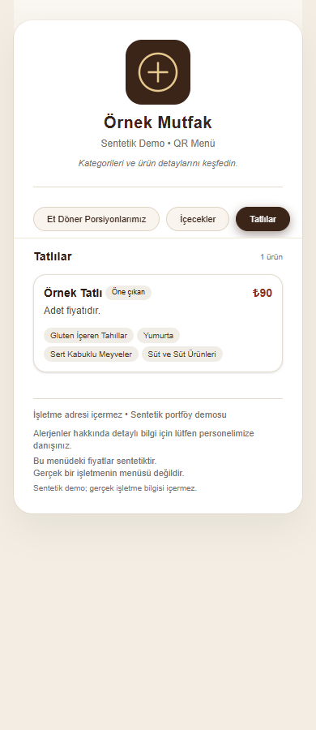

# QR Menü Demo

Mobil bir restoran menüsü arayüzü: açılış ekranından menüye geçiş, kategori seçimi, ürün detay penceresi ve alerjen etiketleri.

Next.js 16.3.8, React 19.2.0, TypeScript 5 ve Tailwind CSS 4 kullanır. Next.js aynı ana sürüm içinde npm audit bulguları nedeniyle güncellendi. Gerçek işletme adı, iletişim bilgileri, fiyatları ve izin durumu belirsiz fotoğraflar bu kopyaya alınmadı. Menüdeki işletme ve fiyat bilgileri sentetiktir; sade SVG demo simgesi kullanılır. Eski özel deponun geçmişi aktarılmadı.

## Kurulum

Node.js 20.9+ ve npm gerekir; doğrulama Node.js 22.17.1 ile yapıldı.

```sh
npm ci
npm run dev -- --hostname 127.0.0.1
# http://127.0.0.1:3000
npm run lint
npm run build
npm start -- --hostname 127.0.0.1
```

Ortam değişkeni, veritabanı veya üyelik gerekmez. Menü verisi data/demo-menu.ts içindedir. /menu sayfası doğrudan açılabilir.

## Doğrulama / sınırlamalar

2026-10-05: üretim derlemesi ve TypeScript kontrolü geçti. Temiz Edge oturumunda açılış yönlendirmesi, kategori değişimi, detay açma/kapatma ve 390 px ekranda taşma kontrolü yapıldı; dış istekler engellendi. Son bağımlılık kontrolünün kesin sonucu yayımlama raporunda kaydedilir. Lint img kullanımına ilişkin performans uyarıları veriyor. Proje bir QR kod üreticisi, sipariş ya da ödeme sistemi değildir; yönetim paneli ve backend içermez. Menü statik kaynak dosyadan gelir. Bağımsız test paketi yoktur.



İşletmenin özel deposu korunmuştur. Bu depo temiz demo kopyasıdır; üçüncü taraf katkılar için yeni lisans eklenmedi.

Bağımlılık kontrolü (2026-10-05): npm audit --omit=dev 0 bulgu verdi. Tam audit geliştirme araçlarının braces / micromatch / fast-glob zincirinde 5 yüksek seviye bulgu bildirdi. Önerilen zorunlu sürüm düşürme uygulanmadı; geliştirme araçlarını güvenilir yerel proje dosyalarıyla kullanın. Bu tarama tüm güvenlik risklerinin yokluğunu garanti etmez.
